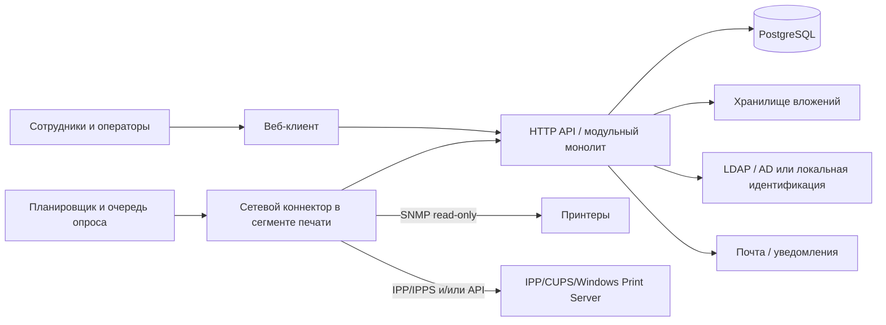

# Архитектура UniPrint

Статус: предварительная целевая архитектура, требует согласования и сверки с инфраструктурой университета. В репозитории уже есть частично реализованный MVP; он не готов к эксплуатации в университете.

## Обнаруженное состояние репозитория

- `pyproject.toml`: пакет Python `uniprint`, требует Python `>=3.14`, зависимостей нет; build backend `uv_build`.
- `src/uniprint/__init__.py`: только консольная `main()`, выводящая Hello; веб-приложения, моделей, API и интеграций нет.
- `README.md` пустой; тестов, миграций, `docs/`, Docker-файлов, CI, конфигурации PostgreSQL, reverse proxy, секретов и окружений нет.
- `AGENTS.md` содержит инструкции первого этапа; `CLAUDE.md` — полное ТЗ и рекомендует Python/FastAPI, SQLAlchemy/Alembic, PostgreSQL и React/TypeScript, но отмечает, что стек следует подтвердить по инфраструктуре.
- Рабочее дерево содержит только неотслеживаемые начальные файлы; ветка `master` без коммитов. Неизвестно, какие из них были созданы до текущего исследования, поэтому существующие файлы не перезаписывались.

## Предлагаемая архитектура

Модульный монолит с одним транзакционным хранилищем, отдельным веб-клиентом и изолированными адаптерами внешних систем. Микросервисы на старте не обоснованы.

### Границы модулей

1. **Identity & Organization:** пользователи, подразделения, роли, области ответственности.
2. **Assets:** принтеры, местоположения, история перемещений и обслуживания, позиции расходников.
3. **Catalog:** модели картриджей, принтеров и совместимость с позицией/цветом.
4. **Inventory:** физические экземпляры, склад, движения, выдача, возврат, инвентаризация.
5. **Service:** заявки, типы работ, конфигурируемые маршруты согласования и SLA.
6. **Cartridge lifecycle:** циклы установки, эксплуатации, возврата, заправки, проверки, ремонта и списания.
7. **Print telemetry:** источники, задания, показания счётчиков, состояние принтера и сверка.
8. **Audit & Reporting:** неизменяемые бизнес-события, аудит доступа и производные отчёты.

### Технологические предложения

- Backend: Python + FastAPI; SQLAlchemy и Alembic — кандидат для ORM и управляемых схем.
- База данных: PostgreSQL — кандидат для транзакций, ограничений и согласованного журнала.
- Frontend: React + TypeScript как SPA, адаптированная под телефон и рабочее место выдачи.
- Фоновые задачи: сначала планировщик с персистентными задачами и блокировкой повторного запуска; очередь вводить при подтверждённой нагрузке/требовании.
- Интеграционный коннектор размещать в сетевом сегменте с разрешённым доступом к принтерам/серверам печати. Основное приложение не должно сканировать сеть.
- Файлы заявок хранить вне БД в контролируемом файловом хранилище, с ограничением типов/размера и ссылкой в БД; вложения отключаемы.

Версии Python и библиотек, поддержка Python 3.14, инфраструктура контейнеров и выбор очереди должны быть проверены на этапе реализации. Инфраструктурного обследования университета в репозитории нет. В локальной среде найден Docker CLI, но Docker Engine сейчас не запущен; `psql`, `pg_isready`, PostgreSQL-сервер, Caddy и AD не обнаружены. Их наличие в целевой инфраструктуре не подтверждено.

## Состояние реализации

- Backend: FastAPI, SQLAlchemy 2.x, PostgreSQL-драйвер psycopg и Alembic подключены. SQLite используется как локальный путь разработки; PostgreSQL не подключался.
- API: `/api` для каталога и активов, заявок, переходов статусов, приёма/выдачи/установки/снятия/возврата картриджа, заправки, ремонта, инспекции и истории движений; `/health` открыт для проверки доступности.
- База: концептуальная модель частично реализована в ORM и ревизиях `0001_initial`–`0003_label_tokens`; модель ещё не покрывает весь документ `DATA_MODEL.md`.
- Идентификация: production IdP не настроен. По умолчанию доменные маршруты закрыты ответом 503. Временный `development` режим принимает synthetic ID/roles только с loopback.
- Frontend: React + TypeScript + Vite, UI доступен на украинском языке; есть заявки, каталоги, складская приёмка, формы выдачи/установки/снятия/возврата, завершение заправки/ремонта/инспекции и реестр активных установок. История движений доступна сотрудникам склада, техникам и администраторам. Production build кладёт статику в `src/uniprint/static`; Vite dev server проксирует `/api` к локальному backend.
- Реальные SNMP/IPP/CUPS/Windows Print Server вызовы отсутствуют. Ни одно устройство не опрашивается.

## Транзакционные правила

- Операция физического перемещения создаёт запись журнала движений и меняет проекцию текущего состояния в одной транзакции.
- Повторяемые команды принимают ключ идемпотентности; уникальные ограничения и блокировка строки исключают двойную выдачу.
- Согласование фиксирует автора, роль/делегирование, время, результат, комментарий и версию маршрута.
- Исправление ошибочного события делается компенсирующим событием со ссылкой на исходное, а не удалением истории.
- Сырые наблюдения мониторинга неизменяемы; исправленные/нормализованные значения сохраняют ссылку на исходное наблюдение.
- Расчёты отчётов воспроизводимы из исходных событий и сопровождаются сведениями о качестве/неполноте данных.

## Эксплуатационные границы

Целевые среда, владелец инфраструктуры, сетевые ACL, RPO/RTO, резервное копирование, домен, сертификаты, почта, файловое хранилище, политика обновлений и размещение данных неизвестны. Это блокирующие входные данные до выбора схемы развёртывания. Никакие службы и сеть не менялись.

## Источники

- [Техническое задание](../CLAUDE.md)
- [Модель данных](DATA_MODEL.md)
- [Мониторинг печати](PRINT_MONITORING.md)
- [Архитектурные решения](DECISIONS.md)
