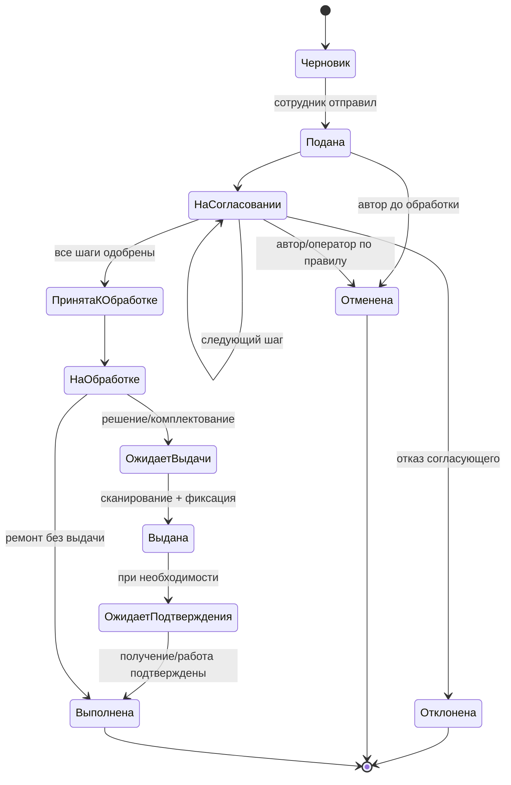
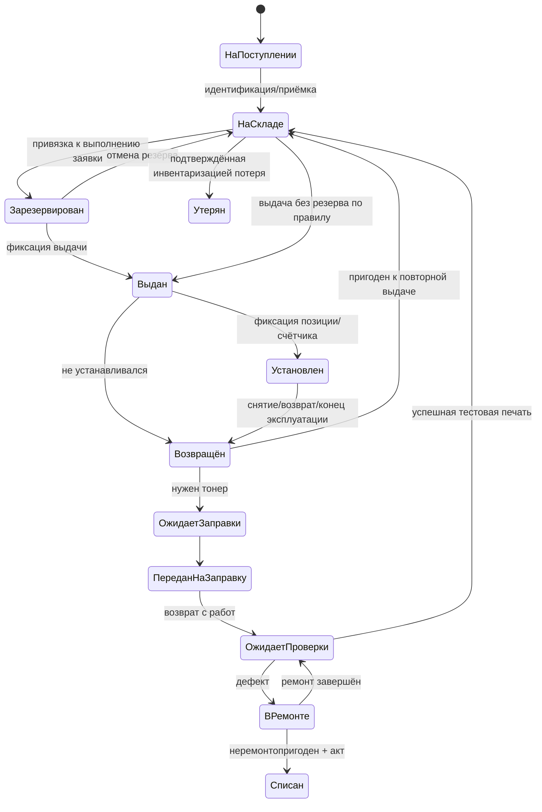

# Бизнес-процессы UniPrint

Это базовое предложение по процессам. Роли, маршруты, материальная ответственность и юридический статус электронных согласований должны подтвердить подразделения университета.

## Заявка: создание — получение расходника

Переход `НаОбработке` может быть достигнут только из `ПринятаКОбработке`; диаграмма показывает укрупнённые состояния. Конкретные разрешённые переходы должны валидироваться сервером и журналироваться вместе с актором.

### Предлагаемая последовательность

1. Сотрудник выбирает своё подразделение, принтер, тип проблемы/операции и нужную помощь. ФИО подтягивается из идентификации; ручной ввод допускается только по подтверждённому исключению. Содержимое документов печати не прикладывать.
2. API присваивает номер, сохраняет снимок значимых атрибутов заявки и запускает версию маршрута, актуальную на момент подачи.
3. Руководитель и/или другие назначенные лица принимают решение с комментарием при отказе. Замена согласующего фиксируется как делегирование. Изменение маршрута не меняет уже созданную заявку.
4. Служба печати проверяет оборудование и уточняет потребность: заправка, обмен, ремонт, дополнительный экземпляр. Система показывает только совместимый доступный экземпляр.
5. Оператор сканирует код картриджа; сервер повторно проверяет совместимость, статус, текущего держателя и отсутствие повторной операции; транзакционно создаёт движение и выдачу.
6. Получение подтверждает сотрудник (веб-аккаунтом/кодом по согласованному процессу) или оператор с указанием способа. Факт подтверждения не объявляется электронной подписью.
7. Возврат фиксируется отдельным событием с состоянием, показанием счётчика и дальнейшим назначением: склад, заправка, ремонт или списание.
8. Для расходника, который был установлен, оператор сначала фиксирует снятие и конечный ручной счётчик. Возврат на склад или сервис блокируется, пока установка открыта.
9. Ремонт закрывается отдельной записью исполнителя и теста, после чего картридж проходит инспекцию. Неуспешная инспекция открывает новый ремонтный цикл; успешная инспекция возвращает экземпляр на склад.

## Жизненный цикл физического картриджа

«Выдан» и «Установлен» — разные факты. Статус `Утерян` требует фиксации расследования/основания, не должен выставляться автоматически. Списание — отдельный авторизованный переход и событие, с основанием и документом, если он требуется внутренними правилами.

В текущей реализации фиксируется одна открытая установка на физический картридж, совместимость с моделью принтера, значения счётчика и акторы установки/снятия. Слоты многоцветного устройства пока не моделируются. Списание в текущем срезе — только операция администратора с обязательной причиной; формальный акт и юридический workflow не реализованы.

### Операционные правила

- Установка открывает запись эксплуатации с показанием на момент установки; снятие закрывает её показанием и причиной.
- Пробег за интервал = конечное показание минус начальное только при совместимой метрике, монотонности и проверенном источнике. Если условия не выполнены, пробег помечается неопределённым.
- Заправка — повторяемый сервисный цикл того же экземпляра. Поступление после заправки не обнуляет накопленный пробег и историю.
- Замена картриджа на устройстве требует закрыть прежнюю установку и открыть следующую; одновременная активная установка одного экземпляра запрещена.
- Действие сканера формирует команду с идемпотентным идентификатором; повторный штрихкод не должен повторно выдавать предмет.
- Исправления делаются компенсирующим событием; физическое движение нельзя удалить или «переписать» задним числом.

## Типы заявки для MVP

Заявка на заправку/обмен, неисправность картриджа, качество печати, неисправность принтера, плановое обслуживание и общий запрос. Повторная заявка на расходник отделяется от заявки на ремонт. Уточнить, допускается ли срочная выдача с последующим согласованием.

## Согласование и юридический статус

На первом этапе система может фиксировать внутренние решения и их контекст. Нельзя считать логин и кнопку «Одобрить» юридически эквивалентными КЭП, электронному документу или утверждённой служебной записке без правовой и делопроизводственной оценки университета. При необходимости юридической значимости — отдельная интеграция с утверждённой системой ЭДО/электронной доверительной услугой и требования к архивированию.
