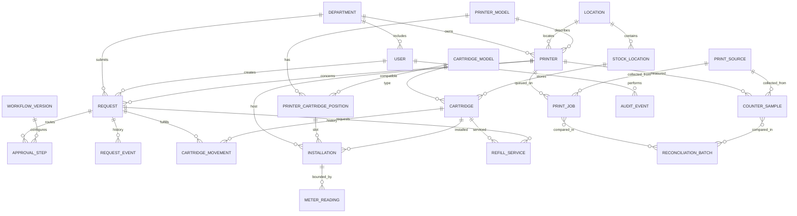

# Предварительная модель данных UniPrint

Схема концептуальная. Типы полей, обязательность, внешние ключи и ограничения должны уточняться после согласования процессов и обследования активов.

Ревизии `0001_initial`, `0002_installations` и `0003_label_tokens` содержат базовые каталоги/заявки/движения, историю установок и случайный QR-токен физического экземпляра. SQL проверен offline, а все ревизии применены на одноразовой SQLite in-memory базе. На постоянную или университетскую базу миграции не применялись. Остальные перечисленные ниже сущности пока проектные.

## ER-диаграмма

## Основные сущности

| Сущность | Назначение и ключевые поля |
|---|---|
| `Department`, `User`, `Role`, `UserRole` | Организационная структура; внешний идентификатор пользователя; активность; дата актуальности членства и области прав. Не хранить лишние кадровые атрибуты. |
| `Location` | Корпус/этаж/кабинет как справочник, чтобы перенос оборудования был прослеживаемым. |
| `PrinterModel`, `Printer` | Производитель, модель, серийный и инвентарный номера, IP/MAC при необходимости, владелец-подразделение, локация, эксплуатационные даты и статус. Сетевые адреса особо ограничить в доступе. |
| `PrinterCartridgePosition` | Позиция расходника устройства: цвет/роль/номер слота, поддерживаемые модели. Не предполагать один картридж на устройство. |
| `CartridgeModel` | Каталожная модель, производитель, артикул, норматив ресурса, условия/источник нормы и версия данных. Норматив не является фактом пробега. |
| `Cartridge` | Конкретный физический экземпляр: UUID, отдельный случайный `label_token` для QR, человекочитаемый код, модель, серийный номер при наличии, дата поступления, текущий статус и число завершённых циклов заправки. |
| `StockLocation` | Склад или зона хранения и ответственное подразделение. |
| `CartridgeMovement` | Неизменяемый журнал движения: экземпляр, тип, from/to место/держатель, время, сотрудник, заявка, причина, ключ идемпотентности, ссылка на компенсируемое событие. |
| `CartridgeService` | Цикл заправки/ремонта: исполнитель/подрядчик, состояние до/после, стоимость/валюта, результат теста, этап проверки, ключ повтора и timestamps. |
| `Installation` (`CartridgeInstallation` в текущем срезе) | Интервал эксплуатации экземпляра на принтере: время установки/снятия, стартовое/конечное ручное показание, состояние и исполнители. Отдельные позиции/слоты и provenance счётчика ещё не реализованы. |
| `MeterReading` | Фиксирует показание и provenance: устройство, значение/единица, дата источника и приёма, автоматический/ручной источник, идентификатор/метод, качество, автор при ручном вводе. |
| `RefillService` | Один цикл обслуживания: передача/возврат подрядчику или специалисту, стоимость/валюта, состояние до/после, результат проверки, цикл, ссылка на запрос и документы. |
| `Request`, `RequestEvent` | Заявка с автором/подразделением/принтером/типом/приоритетом; события статусов и комментарии. Редактирование заявки после запуска маршрута версионируется. |
| `WorkflowVersion`, `ApprovalStep` | Версионированный шаблон условий и последовательности; конкретные задачи согласования с назначенным субъектом, решением, временем и основанием делегирования. |
| `PrintSource`, `PrintJob` | Коннектор и источник данных; задание с внешним устойчивым ID, принтером, пользователем если доступен, временем, статусом, impressions/sheets/pages раздельно и точностью атрибутов. Без содержимого и, по умолчанию, без имени документа. |
| `CounterSample` | Неизменяемое чтение общего/цветового/моно-счётчика, статуса, consumable-level с OID/IPP-атрибутом, исходной единицей, временем и качеством. |
| `ReconciliationBatch` | Сопоставление job-потока и дельты счётчиков по устройству/периоду: сопоставлено, необъяснённая разница, отсутствующие интервалы, исключения и версия алгоритма. |
| `AuditEvent` | Актор, действие, тип/ID объекта, результат, время, корреляция, минимально необходимые изменения; защита от незаметного редактирования и отдельная политика хранения/экспорта. |

## Инварианты и ограничения

- Физический экземпляр уникален по внутреннему идентификатору; QR содержит случайный токен `UPC:<UUID>`, а не персональные данные. Сканирование принимает токен в тех же операциях, что и человекочитаемый код.
- У картриджа в каждый момент не более одного активного места/владельца и одной открытой установки; ограничения БД дополняются транзакционной блокировкой.
- Установка допускается только в совместимую позицию и при корректном доступном статусе.
- Для закрытого цикла установки конечное показание не меньше начального, кроме зарегистрированного reset/замены счётчика с причиной и оператором.
- Неизвестные или неподдерживаемые источником метрики хранятся как `unknown`/`not_supported`, а не как ноль.
- Задание печати и показание счётчика имеют собственную идентичность источника и не сливаются в одно «истинное» значение.
- Денежные значения используют decimal и валюту; историческая цена не перезаписывается текущим справочником.
- История движений, решений и телеметрии не удаляется при смене текущего статуса.

## Открытые вопросы схемы

Решить до миграций: инвентарный учет по требованиям университета; допустимость табельного/внешнего ID; потребуется ли учет барабанов/бункеров/ленточных блоков помимо картриджей; несколько принтеров/позиции и цветовой счётчик; валюты/налоги/подрядчики; сроки хранения заданий и аудита; идентичность однофамильцев и гостевых сотрудников.
