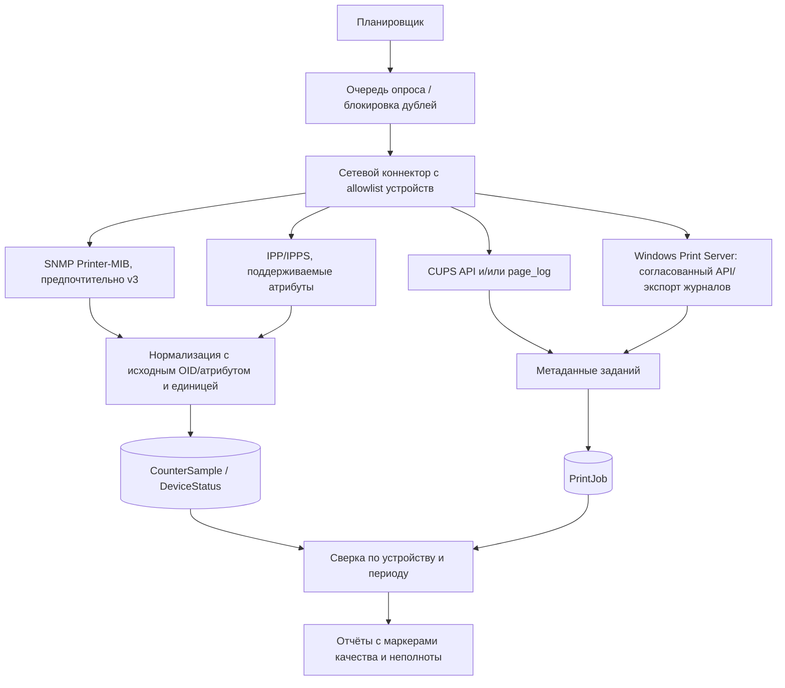

# Мониторинг печати и сопоставление показаний

## Ключевой вывод

Универсального источника, который гарантированно сообщает все показатели на любом принтере, нет. SNMP Printer MIB описывает управляемые характеристики устройства, включая счётчики/состояние/расходники, но конкретная модель может не предоставлять нужные объекты. IPP предоставляет атрибуты заданий, однако поддержка и сохранность истории зависят от реализации и политики. CUPS умеет журналировать задания/страницы при настройке и поддержке драйвера. Windows Print Server может быть источником заданий при наличии соответствующих разрешений и включённого аудита. Реальную полноту подтвердить только пилотом на оборудовании университета.

## Предлагаемая архитектура интеграции

Коннектор работает только по заранее заданным адресам/очередям. Запросы — чтение; функции обнаружения и сетевого сканирования выключены. Ошибки/таймауты не заменяются нулём. Нужны ограничение частоты, backoff, очередь, расписание и метрики отказов. Секреты источников хранятся отдельно от обычных настроек.

## Возможности источников

| Источник | Что может дать | Ограничения и требования |
|---|---|---|
| SNMP + Printer MIB | Идентичность, доступные счётчики marking subunit, статусы/ошибки, consumables, уровни/остаток в зависимости от устройства. | Поддержка и семантика зависят от прошивки, MIB и модели; индексированные OID нужно обнаруживать и сопоставлять по устройству; возможны сброс/переполнение/разные единицы. SNMPv3 предпочтителен. v1/v2c передают community как общий секрет без защиты уровня v3 — разрешать лишь после сетевой и безопасностной оценки. Только read-only и ACL. |
| IPP/IPPS | Очередь/устройство и атрибуты задания, состояние и доступные completed impressions/media sheets; иногда consumables/device status. | Атрибуты могут быть неподдерживаемы, неизвестны или доступны лишь до очистки задания. IPP impressions, листы и счётчик устройства имеют разную семантику. Требуется тестировать как сервер, так и принтер. |
| CUPS | Журналы заданий/страниц: очередь, пользователь, job ID, время, счётчик страниц при соответствующей конфигурации. | `page_log` выключен пустым форматом по умолчанию; документация отмечает зависимость page accounting от драйвера/устройства. Изменение конфигурации CUPS — отдельное согласованное действие владельца инфраструктуры. Нужно сохранять/экспортировать до ротации по согласованной политике. |
| Windows Print Server | Метаданные очередей и заданий/событий спулера, в зависимости от версии Windows, настроек аудита и способа доступа. | Журналы могут быть отключены, ротироваться, иметь ограниченную детализацию; необходимо подтвердить необходимые поля и API на конкретной версии. Нужны служебная учётная запись с минимальными правами и одобрение Windows-администраторов. Не собирать содержимое spool-файлов. |
| Ручной ввод | Показания при установке/снятии и инвентаризации для любого устройства. | Требует оператора, времени, фото/основания при необходимости и проверки аномалий; это не автоматическое измерение. |

## Различие метрик

- **IPP job impressions/pages** — стороны, обработанные в рамках задания по семантике протокола/реализации.
- **Media sheets** — физические листы; при duplex один лист может содержать две стороны/impressions.
- **Счётчик устройства** — кумулятивное показание принтера, которое может учитывать автономные страницы, тесты, копирование и задания вне наблюдаемой очереди.
- **Job queue counters** — страницы/стороны, принятые или обработанные сервером, не всегда физически выведенные устройством.
- **Пробег картриджа** — дельта подходящего счётчика за интервал его фактической установки. Для цветного/многокартриджного устройства общий счётчик не даёт автоматически пробег каждому отдельному картриджу.

Система хранит значения раздельно, с названием метрики, источником и единицей. Сопоставление не корректирует сырые данные и не приписывает задания конкретному картриджу без подтверждённого интервала.

## Сверка заданий со счётчиком

1. Зафиксировать показания и время `t0` и `t1` устройства (желательно точные timestamps источника).
2. Выбрать из источника заданий тот же принтер/очередь, окно времени и понятную метрику completed impressions/sheets; учитывать часовой пояс и задержку журналирования.
3. Вычислить дельту устройства только если счётчик монотонен, единицы совпадают и между выборками нет reset/замены/потери периода.
4. Сравнить `delta_device` с агрегатом заданий, оставляя разницу как `unattributed_delta`; не перераспределять молча.
5. Классифицировать расхождения: offline/direct printing, копир/встроенные отчёты, задания вне сервера, canceled/failed/reprint, тестовые страницы, duplex/copies, задержка/пропуск логов, reset/rollover, несовпадение принтера или единицы.
6. Хранить версию алгоритма, допуски, покрытие наблюдения и объяснения исключений. Показывать диапазон/неполноту, когда точность неизвестна.

Метрология: автоматическая дельта счётчика — не доказательство числа листов, использованной бумаги или тонера. Расход тонера не выводить из числа страниц без проверенной модели/калибровки.

## Рекомендуемая последовательность пилота

1. Собрать инвентарный список моделей/прошивок и способа подключения — без сканирования сети.
2. Получить согласованные тестовые адреса, read-only учётные данные и версии серверов печати.
3. Проверить по одной репрезентативной модели на каждую группу устройств: доступность MIB/IPP атрибутов, метрики, resets, polling interval, журналирование заданий.
4. Сравнить наблюдения с операторскими показаниями/контрольной печатью в заранее утверждённом пилоте.
5. Утвердить покрытие, срок хранения, разрешения и переход к промышленному сбору.

## Первичные источники

- [IETF RFC 3805 — Printer MIB v2](https://www.rfc-editor.org/rfc/rfc3805.html)
- [IETF RFC 3414 — User-based Security Model for SNMPv3](https://www.rfc-editor.org/rfc/rfc3414.html)
- [IETF RFC 8011 — IPP/1.1 Model and Semantics](https://www.rfc-editor.org/rfc/rfc8011.html)
- [CUPS: cupsd logs](https://openprinting.github.io/cups/doc/man-cupsd-logs.html)
- [CUPS: PageLogFormat](https://openprinting.github.io/cups/doc/man-cupsd.conf.html)
- [Microsoft: Windows print job management](https://learn.microsoft.com/en-us/windows-hardware/drivers/print/job-management)
